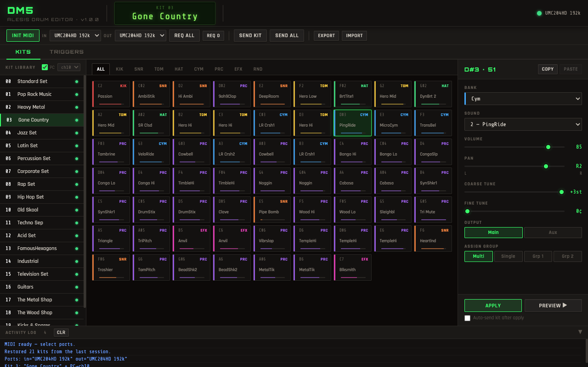

# Alesis DM5 Editor

A Mac desktop editor for the Alesis DM5 MIDI drum module. Edit all 21 kit slots, browse and assign sounds from the full 552-voice library, adjust tuning and mix settings, and send/receive kits over MIDI SysEx — all without menu-diving on the module itself.



---

## Features

- **Full kit editor** — volume, pan, bank, sound, coarse/fine tune, output (main/aux), assign group for all 61 pads per kit
- **Complete 552-voice sound library** — all 8 banks with official Alesis voice names
- **Live NRPN preview** — hear sound changes in real time as you edit
- **Program Change on kit select** — clicking a kit in the browser switches the module to it instantly
- **Trigger Setup screen** — request and edit all 12 trigger parameters (gain, velocity curve, cross-talk, noise floor, decay)
- **Kit Drum Map** — edit trigger note assignments, root note, and footswitch notes per kit
- **Send / Receive all 21 kits** — with correct SysEx timing
- **Export / Import JSON** — save and restore your entire kit library
- **Copy / Paste pads** between kit slots
- **Activity log** — full visibility of all MIDI communication
- **Works offline** — no internet connection needed
- **Logic Pro plugin** — the same editor as an Audio Unit MIDI FX that saves your kits in the Logic project (see below)

---

## Requirements

- Mac (macOS 10.15 or later, Intel or Apple Silicon)
- Alesis DM5 drum module
- MIDI interface with 5-pin DIN connectors
- Two MIDI cables: one from your interface MIDI OUT to DM5 MIDI IN, one from DM5 MIDI OUT to interface MIDI IN

---

## Install and run from source

Requires [Node.js](https://nodejs.org) (v18 or later).

```bash
git clone https://github.com/suavekeith/Alesis_DM5_Editor.git
cd Alesis_DM5_Editor
npm install
npm start
```

`npm start` first assembles the UI into `plugin/WebUI/` (via `plugin/scripts/build-webui.sh`), then launches the app. Edit `DM5Editor.html`, not the files in `plugin/WebUI/`.

---

## Build a distributable DMG

```bash
npm run dist
```

This produces an Intel + Apple Silicon universal DMG in the `dist/` folder.

---

## Usage

1. Launch the app and click **INIT MIDI**
2. Select your MIDI interface in the **IN** and **OUT** dropdowns
3. Click **REQ ALL** to load all 21 kits from the module
4. Click any kit in the browser to select it — the module switches to it via Program Change
5. Click a pad to open the editor panel, make changes, then click **APPLY**
6. Click **SEND KIT** to write the edited kit back to the module. If the kit is the one the module is playing (and the **PC** box is ticked), it is also loaded into the module's edit buffer so you hear the change straight away

For trigger settings, click the **TRIGGERS** tab, press **REQUEST SETUP**, then adjust gain, velocity curve, cross-talk, noise floor and decay for each of the 12 triggers.

---

## Logic Pro plugin

The editor is also available as an Audio Unit MIDI FX for Logic Pro. It has the same features as the app, and adds:

- **Kits saved with the Logic project** — the kit library, trigger setup, MIDI ports, channel and settings are stored in the project and come back when you reopen it
- **Send on project open** — optionally send all kits, or just the active kit, to the DM5 when the project opens, without opening the plugin window
- **Transfers keep running** if you close the plugin window

The plugin talks to the DM5 directly through your MIDI interface, alongside Logic's own use of the same ports.

### Build and install

Requires the Xcode Command Line Tools (`xcode-select --install`), [Homebrew](https://brew.sh), Node.js and:

```bash
brew install cmake ninja
```

Then, from the repository folder:

```bash
git submodule update --init
npm install
cd plugin
cmake -B build -G Ninja -DCMAKE_BUILD_TYPE=Release
cmake --build build --config Release
```

The build installs `DM5 Editor.component` into `~/Library/Audio/Plug-Ins/Components/`. Restart Logic (or use **Logic Pro → Plug-in Manager → Reset & Rescan Selection**) to pick it up. To check it independently of Logic:

```bash
auval -v aumi Dm5e Kwln
```

The build also produces a standalone version at `plugin/build/DM5Editor_artefacts/Release/Standalone/DM5 Editor.app`.

### Use in Logic

1. On a software instrument track, insert Logic's **External Instrument** set to your MIDI interface and the DM5's channel
2. In the **MIDI FX** slot above it, choose **DM5 Editor** (under Audio Units → DM5 Editor). The track's MIDI passes through unchanged
3. Open the plugin window and select your interface in **IN** and **OUT** (no INIT MIDI click needed), then use it as you would the app
4. To have the DM5 set up automatically, choose **SEND ALL KITS** or **SEND ACTIVE KIT** in the **ON OPEN** menu at the right of the toolbar, then save the project

If the saved MIDI interface isn't connected when the project opens, nothing is sent; the activity log and status light say which port is missing, and the saved selection is kept for next time. If more than one DM5 Editor in the project uses the same MIDI output, the log shows a warning.

### Licence note

The plugin is built with [JUCE](https://juce.com), which is free under the JUCE Personal licence or AGPLv3. That is fine for personal use; check JUCE's licence terms before distributing plugin builds.

---

## Resources

- [Alesis DM5 product page](https://www.alesis.com/products/view/dm5)
- [Alesis DM5 Sound Chart](https://www.alesis.com/rscdn/1580/documents/dm5_soundchart.pdf)

---

## License

MIT — see [LICENSE](LICENSE)
